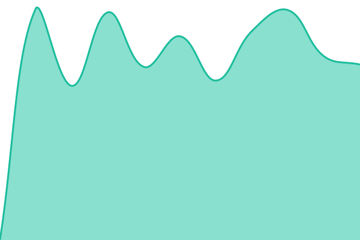

# Status · Painel da Revenda

Monitoramento de disponibilidade do [Painel da Revenda Gdoor](https://painel.gdoor.com.br), feito com [Upptime](https://upptime.js.org).

<!--start: status pages-->
<!-- This summary is generated by Upptime (https://github.com/upptime/upptime) -->
<!-- Do not edit this manually, your changes will be overwritten -->
<!-- prettier-ignore -->
| URL | Status | History | Response Time | Uptime |
| --- | ------ | ------- | ------------- | ------ |
|  [Painel da Revenda](https://painel.gdoor.com.br) | Operacional | [painel-da-revenda.yml](https://github.com/gdoor-sistemas/uptime-painel-revenda/commits/HEAD/history/painel-da-revenda.yml) | 

 791ms
     
 | 

<a href="https://gdoor-sistemas.github.io/uptime-painel-revenda/history/painel-da-revenda">100.00%</a>
    

|  [Login da Revenda](https://painel.gdoor.com.br/rev/login) | Operacional | [login-da-revenda.yml](https://github.com/gdoor-sistemas/uptime-painel-revenda/commits/HEAD/history/login-da-revenda.yml) | 

 739ms
     
 | 

<a href="https://gdoor-sistemas.github.io/uptime-painel-revenda/history/login-da-revenda">100.00%</a>
    

<!--end: status pages-->

Sites e visual configurados em [.upptimerc.yml](.upptimerc.yml). Os arquivos em `.github/workflows` são gerados pelo Upptime — não edite diretamente.

> **Este repositório precisa ser público.** A página de status busca os dados direto do GitHub no navegador de quem acessa, e o Upptime não gera o site em repositório privado. Em repositório privado as Actions também passariam a consumir minutos (o Uptime CI roda a cada 5 minutos). Aqui só há URLs públicas do painel e tempos de resposta; o token `GH_PAT` fica em _Secrets_.
